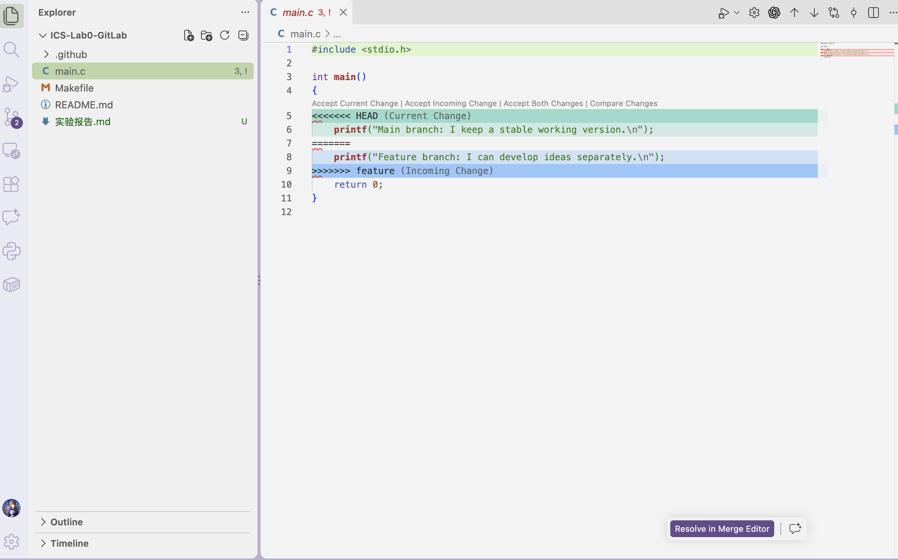
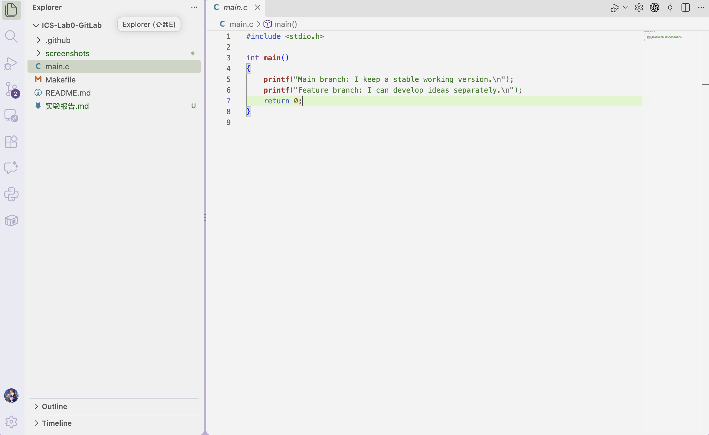

# Lab0：GitLab 实验报告

## 一、Git 基础问题

### 1. 多人协作经历

我参与过 [InspireSkill](https://github.com/realZillionX/InspireSkill) 的多人开发。我们按功能分工，在各自分支提交修改，再通过 GitHub Pull Request 讨论、检查并合并到主分支。这样每个人的改动都有清楚的记录，也方便发现和处理相互影响的修改。

### 2. 为什么要分“暂存”和“提交”两步？

工作区可能同时包含已完成的功能、正在调试的代码和临时改动。如果修改后立即提交，历史就容易混入不相关或未完成的内容。暂存区让我先挑选本次提交的文件或代码片段，检查提交范围，然后再把它们固定成一个有明确目的的版本。例如修改程序时，可以只暂存已验证的 `main.c`，不把临时生成的可执行文件纳入提交。这样产生的提交更容易审查、回退和复用。

### 3. `git branch` 与 `git branch -a` 的区别

不带参数的 `git branch` 默认只列出本地分支；`git branch -a` 同时列出本地分支和本地保存的远程跟踪分支，例如 `remotes/origin/main`。星号表示当前所在的本地分支。`-a` 展示的是本地已获取的远程分支信息，若要更新这些信息需先执行 `git fetch`。依据：[Git 官方 `git-branch` 文档](https://git-scm.com/docs/git-branch)。

## 二、拓展阅读与理解

我选择阅读以下两篇材料：

1. [《Commit message 和 Change log 编写指南》](https://www.ruanyifeng.com/blog/2016/01/commit_message_change_log.html)：文章介绍结构化提交说明中的类型、影响范围和简短主题，以及可选的正文与脚注。清楚的提交信息让协作者快速理解修改意图，也便于筛选历史和生成版本变更记录。本实验的提交信息使用了 `feat:` 等类型前缀。
2. [《语义化版本 2.0.0》](https://semver.org/lang/zh-CN/)：版本号由主版本号、次版本号和修订号组成。公共 API 出现不兼容修改时提升主版本号；增加向下兼容功能时提升次版本号；修复向下兼容的问题时提升修订号。它使依赖方能从版本变化判断升级风险。

我认为学习 Git 不只是为了备份代码。Git 的提交记录说明每次修改的原因，分支让新工作不干扰当前稳定版本，合并机制帮助多人整合成果。清楚的提交历史还能为后续发布版本、定位问题和回滚提供依据。

## 三、实验过程

1. 使用课程提供的 [GitLab 模板仓库](https://github.com/ICS-26Fall-FDU/GitLab) 创建[个人仓库](https://github.com/realZillionX/ICS-Lab0-GitLab)，保留模板中的自动评分工作流。
2. 克隆个人仓库，将 `main.c` 中的 `@TODO` 与原始 `Hello, world!` 输出改成自选句子，执行 `make`、`./main` 和 `make clean`，确认可编译和运行。提交为 `dff3da9`。
3. 从 `main` 创建 `feature` 分支，在 `main.c` 的输出语句上作修改并提交为 `4ae49f1`。
4. 切回 `main`，在相同的输出语句上作另一种修改并提交为 `26f9abf`。
5. 在 `main` 执行 `git merge feature`。两个分支从同一个基点修改了同一行，Git 无法判断应保留哪句输出，因此报告 `CONFLICT (content): Merge conflict in main.c`。
6. 手动检查 `<<<<<<< HEAD`、`=======`、`>>>>>>> feature` 标记，将两种输出都保留，删除冲突标记，再暂存并完成合并提交 `008948d`。之后重新编译、运行，确认输出两句话。

### 冲突证据

合并命令返回：

```text
Auto-merging main.c
CONFLICT (content): Merge conflict in main.c
Automatic merge failed; fix conflicts and then commit the result.
```

下图为合并中 `main.c` 的实际冲突状态：



解决后，`main.c` 保留两个分支的输出，且不再包含冲突标记：



运行结果：

```text
Main branch: I keep a stable working version.
Feature branch: I can develop ideas separately.
```

## 四、体会

本次实验里，冲突并非 Git 操作失败，而是两项合理的修改在同一位置互相竞争。处理时需要理解两边改动的意图，不能只机械地选“当前”或“传入”。把两个版本的输出都保留下来后，编译和运行才能验证合并结果符合预期。
